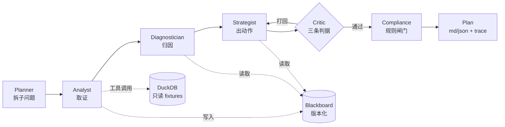

# membergraph

**会员增长多智能体工作台** —— 给定一个业务议题，六个角色协作产出**带证据链、经得起反驳、过得了合规**的增长方案，全过程可回放。

```bash
pip install -e ".[dev]"
membergraph run "9月复购率环比下滑，给出一个30天挽回方案" --provider fake -o runs/demo
```

不需要 API key。`fake` provider 用确定性规则替代模型决策，但**所有数字都来自真实的本地查询**。

---

## 它解决什么问题

单 Agent 做增长分析有三个死穴：

| 问题 | 常见做法 | membergraph 的做法 |
|---|---|---|
| 结论没有依据，模型会编 | 在 prompt 里写"不要编造" | 每条 `Claim` 必须挂 `evidence_id`，引用不存在的证据在生成阶段就被丢弃 |
| 方案没人反驳，越写越顺 | 让模型"自我检查" | 独立的 Critic 角色按三条判据打回，打回必须给 `failure_code` 和修复建议 |
| 出了问题无法复盘 | 打日志 | JSONL 事件流 + 单文件 HTML 时间轴，能看清每一步谁做了什么 |

---

## 架构



**六个角色**

| 角色 | 职责 | 关键约束 |
|---|---|---|
| Planner | 把议题拆成 3-4 个可验证子问题 | 每个子问题必须绑定已注册指标 + 允许维度 |
| Analyst | 调工具取证 | 不能偷换指标；维度不支持时自动回退并记 trace |
| Diagnostician | 写归因结论 | 引用不存在的证据 → 该条结论被丢弃 |
| Strategist | 出人群/渠道/权益/时点/预算/指标 | 无证据的动作不进入方案 |
| Critic | 反驳 | 证据不足 / 成本超限 / 动作缺失，最多 2 轮 |
| Compliance | 合规终审 | 绝对化用语、PII、折扣击穿、夸大提升，**规则不是提示词** |

---

## 四个核心机制

### 1. 证据账本（Evidence Ledger）

```python
class Claim(BaseModel):
    text: str
    evidence_ids: list[str] = Field(min_length=1)   # 空列表直接校验失败
```

- 无证据的结论无法构造
- 引用了不存在的 `evidence_id` → Diagnostician 丢弃、Compliance 兜底拦截
- 每条 `Evidence` 带 `query` 和 `digest`，可复算

### 2. 预算感知的诚实降级

```python
Budget(max_usd=0.6, max_tool_calls=30, max_wall_ms=120_000)
```

超预算不崩溃、不静默继续，而是：

```
砍掉剩余子问题 → 跳过结构分解 → 只跑一轮评审 → 输出标注 degraded=true + 原因
```

`tests/test_orchestrator.py::test_budget_exhaustion_degrades_honestly` 验证了这条路径。

### 3. 可回放的 trace

```bash
membergraph replay runs/demo/trace.jsonl -o runs/demo/replay.html
```

生成单文件 HTML：每个 agent 一条泳道，事件按时间落点，点击看完整 payload。无外部依赖。

### 4. 版本化黑板

每次写入产生新 revision，历史不可篡改。可以回答"这条结论在第几轮被谁改过"。

---

## 评测

```bash
python evals/run.py
```

6 个用例，实测结果（2026-10-21，`provider=fake`）：

| case | 议题 | 证据 | 结论 | 动作 | 阻断 | 结果 |
|---|---|---|---|---|---|---|
| `repurchase_drop` | 9月复购率环比下滑 | 4 | 2 | 2 | 0 | ✅ |
| `churn_rise` | 沉睡会员占比上升 | 3 | 2 | 2 | 0 | ✅ |
| `aov_upt` | 客单价涨但连带率降 | 4 | 3 | 2 | 0 | ✅ |
| `active_decline` | 活跃率连续两月走弱 | 3 | 2 | 2 | 0 | ✅ |
| `tight_budget` | 预算压到 6000 元 | 4 | 2 | 2 | 0 | ✅ |
| `forced_degradation` | 工具调用上限 3 次 | 1 | 2 | 2 | 0 | ✅（按预期降级） |

> **6/6 通过**，单例耗时约 0.2s（随机器波动，故不写死毫秒数）。
> 完整报告见 `evals/report.md`，原始结果见 `evals/results.json`。
> 注意：这验证的是编排与治理机制，**不评估真实模型的推理质量**。

**关于成本数字**：报告里的 `$0.0077` 不是账单。`fake` provider 按固定费率 0.00018/次记账，用来验证计费链路和预算中断，**全程没有任何网络请求、没有模型、没有 API key，实际花费 0 元**。换 `--provider deepseek` 才会产生真实费用。

```bash
python -m pytest    # 44 passed
```

---

## 几个真实踩过的坑（都在测试里留了回归）

1. **按维度查询时把分组值当成了整体值**
   `return_rate` 按品类查，返回的第一行是塑身（18%），被当成整体值。修复后整体值与分组值分开计算。
   回归：`test_dimension_query_returns_overall_value_not_a_group`

2. **复购率用了首单 cohort，被右删失打穿**
   9 月首单的会员还没走完 90 天，复购率趋近 0——看起来像业务崩了，其实是口径错。
   改成滚动 90 天窗口，月度可比。回归：`test_repurchase_uses_rolling_window_not_immature_cohort`

3. **在元和百分比之间做"最大变化"比较**
   客单价变化 -57 元被格式化成 -57.5pct，还把客单价误判成主指标。
   修复：主指标由 Planner 指定，涨跌幅按 `unit` 格式化。

4. **留存曲线不是单调的**
   一开始写了"留存必须递减"的测试，结果 618 大促让第 3 个窗口反弹。
   不是 bug，是业务。测试改成只校验值域。

---

## 设计取舍

**为什么不用 LangGraph？**
这个项目需要三样东西：黑板版本化、预算中断后的降级、trace 与状态解耦。用图框架要先绕开它的状态模型，再补一层自己的账本，反而更绕。~150 行自研编排换来完全可控的中断语义。如果只是 `agent ⇄ tools` 循环，LangGraph 是更好的选择。

**为什么 fake provider 不是 mock？**
mock 返回假数据，测不出任何东西。fake 用规则替代**决策**，数字仍从仓库真实查出——所以它能验证"证据是否落到账本""预算超了会不会降级"，只是不能验证"模型归因准不准"。这个边界写在 README 里，不模糊。

**为什么合规用正则不用 LLM？**
提示词说"避免绝对化表述"是建议，正则拦截是控制。能确定性判定的，不交给模型。

---

## 常见问题

**Q：`pip install .` 之后运行提示「找不到本地 fixtures」？**

`data/fixtures` 随仓库分发，不打进 wheel。三种解法：

```bash
pip install -e ".[dev]"           # 1) editable 安装（推荐）
cd membergraph && membergraph ...  # 2) 在仓库根目录运行，会自动探测 ./data/fixtures
membergraph ... --data /path/to/fixtures   # 3) 显式指定
```

CLI 会打印它尝试过的路径和对应的解决方式，不会只甩一个 traceback。

**Q：没有 API key 能跑吗？**

能。`--provider fake` 用规则替代模型决策，数字全部来自本地查询。`--provider deepseek` 才需要 `DEEPSEEK_API_KEY`。

**Q：为什么 6 个角色不互相直接对话？**

全部通过黑板读写。自由对话难以复现、难以归因、token 不可控。代价是新增角色必须改编排，不能"agent 自己找人聊"。

---

## 目录

```
membergraph/
├── src/membergraph/
│   ├── contracts.py        # Pydantic 契约（Claim/Evidence/Action/Plan）
│   ├── blackboard.py       # 版本化黑板
│   ├── budget.py           # 预算与降级
│   ├── orchestrator.py     # 编排主流程
│   ├── agents/             # 六个角色
│   ├── tools/              # 指标 / cohort / 实验 / 仓库
│   ├── llm/                # fake + OpenAI 兼容
│   ├── observability/      # trace + replay
│   └── cli.py
├── data/fixtures/          # 合成数据（8,000 会员 / 23,697 订单）
├── evals/                  # 6 个用例 + 报告
├── tests/                  # 44 个测试
└── docs/                   # 指标口径 / 架构 / 决策记录
```

---

## 边界

- 数据全部为合成数据（见 `docs/DATA_ASSUMPTIONS.md`），不含任何企业真实数据
- `deepseek` provider 代码完整但未在 CI 验证（需要 API key），CI 只跑 `fake`
- 单进程、无并发控制；黑板在内存中，进程退出即丢失（trace 与 plan 已落盘）
- 指标只有 8 个，够支撑演示，不覆盖完整会员体系

## License

MIT
